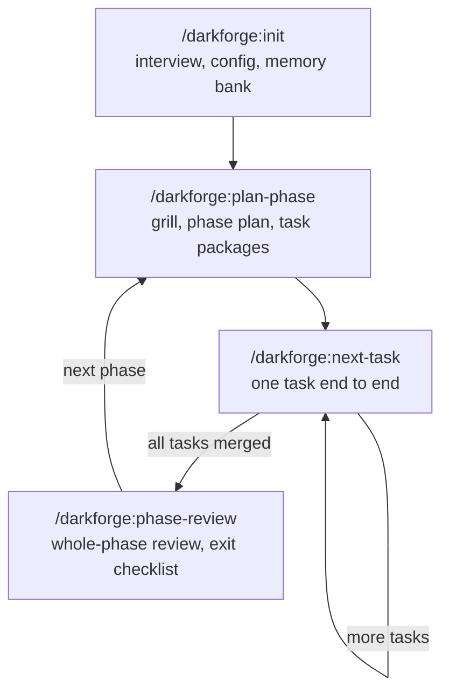
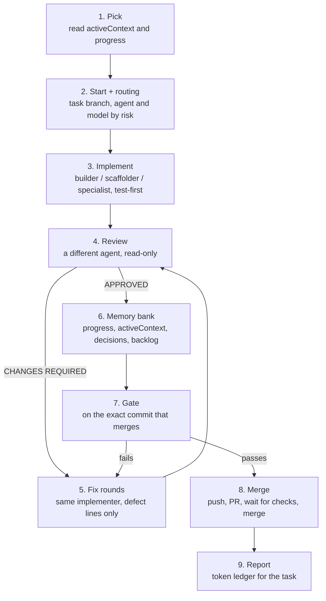

# darkforge

A Claude Code plugin that runs an AI-first project: phase plans and small task packages, risk-based model routing, an independent review for every task, a quality gate, pull-request merges, a short memory bank and a token ledger.

## Why

Long AI sessions drift and get expensive: they re-read whole specs, pick models by habit, review their own work and forget what was decided. darkforge keeps each session small and checkable:

- every task is built by one agent on its own branch and reviewed by a different one;
- the model for each task comes from the project's routing by risk, is always explicit, and banned models are blocked by a hook;
- the gate must pass on the exact commit that merges;
- the memory bank holds only the current state, so a new session reads two short files;
- the mechanical steps (branch, memory-bank commit, lint, gate, merge) are two CLI commands, `task begin` and `task finish`, so the main session's model calls go to judgment;
- the ledger shows tokens per task, per model and orchestrator vs subagents.

The main session is where most tokens go: in the first measured end-to-end run it used 85% of them. With `task begin` / `task finish` one task's main-session model calls fell from 21 to 8 in a re-run on the same project (one measurement; details in [docs/testing/e2e-checklist.md](docs/testing/e2e-checklist.md)). Run one task per session: see [keeping token use down](docs/user-guide.md#keeping-token-use-down).

No npm dependencies, no network access except `git` and `gh`, no telemetry.

## Install

```
/plugin marketplace add tuanluu-agilityio/darkforge
/plugin install darkforge@darkforge
```

## Requirements

- Claude Code 2.1.330 or newer (tested), with plugin support; older builds may not run exec-form hooks, and the guard then never runs
- Node.js 18 or newer
- `git`; `gh` for the pull-request flow
- Windows, macOS or Linux

## Quick start

1. `/darkforge:init` in your repository: answer the interview (one question at a time).
2. `/darkforge:plan-phase`: plan the first phase and its task packages.
3. `/darkforge:next-task`: run one task end to end; then `/clear` and repeat.
4. `/darkforge:phase-review`: close the phase.
5. `/darkforge:status` at any time.

Read the [user guide](docs/user-guide.md), the [config reference](docs/config.md) and a [worked example](docs/example-dark-clipboard.md).

## Workflow

Each phase is planned once, built one task at a time and closed by a whole-phase review. `/darkforge:status` is read-only and can run at any point.



### One task (`/darkforge:next-task`)



- The model comes from `routing.<risk>` in `.darkforge/config.json`; a task that touches a `riskAreas` path is always `high`. Banned models are blocked by a hook.
- After `escalation.raiseAfterFixRounds` fix rounds the model is raised one tier; after `escalation.askOwnerAfterFixRounds` the owner is asked.
- `should-fix` review items do not block; they go to `memory-bank/backlog.md`.
- The phase review is done by `security-reviewer` at the `high` reviewer model. Each `blocking` defect becomes a new fix task in the phase.

## Credits

- [superpowers](https://github.com/obra/superpowers) by Jesse Vincent (MIT) inspired the skill-driven workflow. darkforge uses it when installed and works without it.
- The one-question-at-a-time `grill` skill is based on the grill-me idea by Matt Pocock (MIT).
- The process comes from Dark Clipboard, a project by Tuan Luu.

No text from these projects is copied here.

## License

MIT. See [LICENSE](LICENSE).
